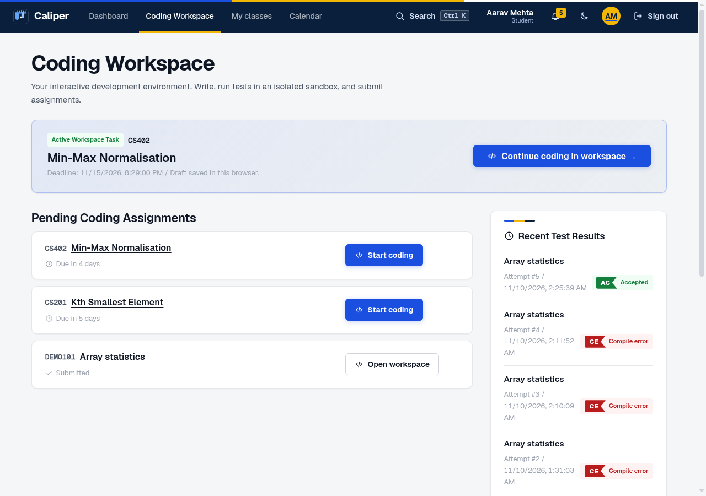
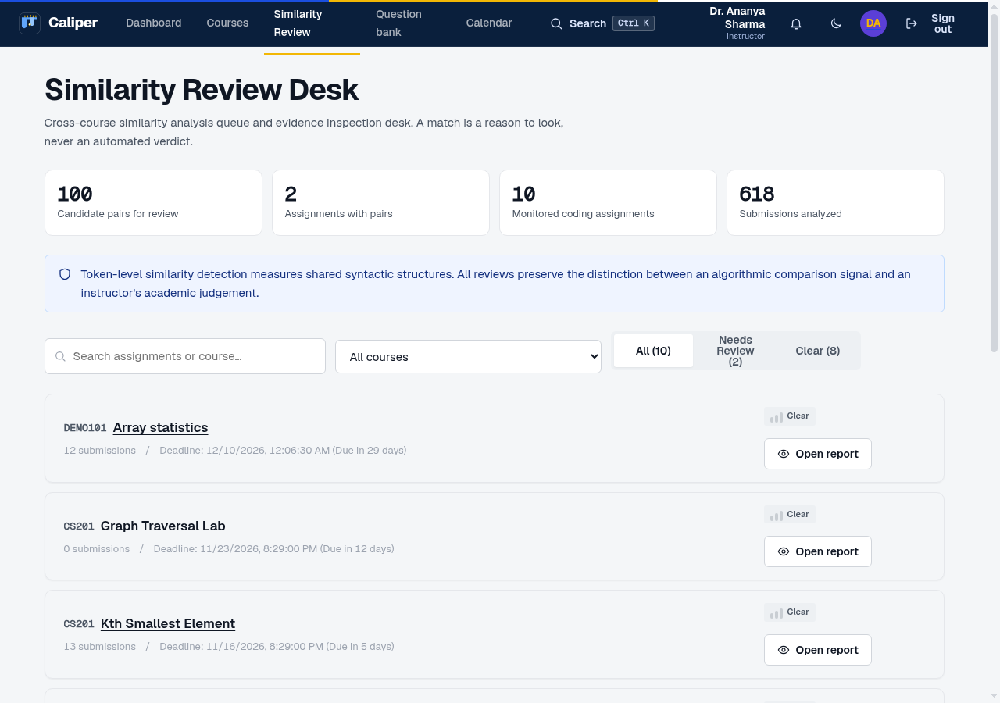
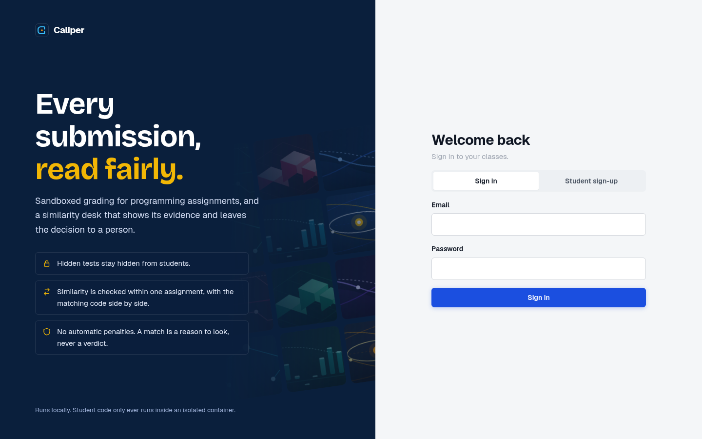
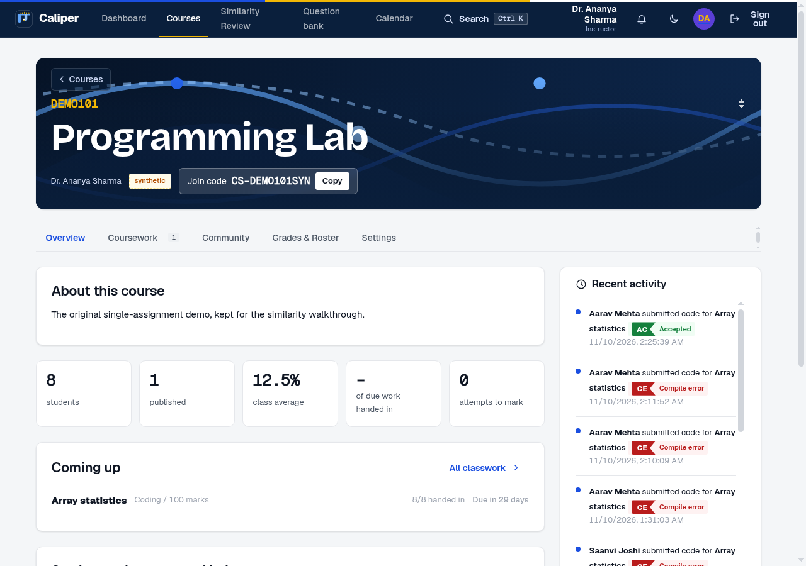
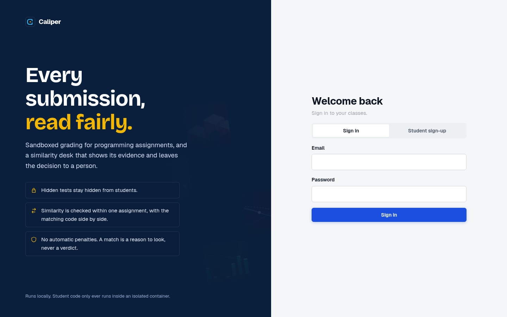
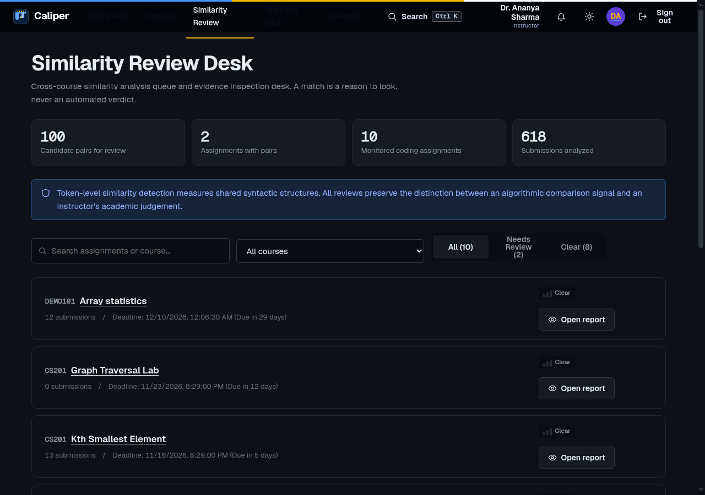
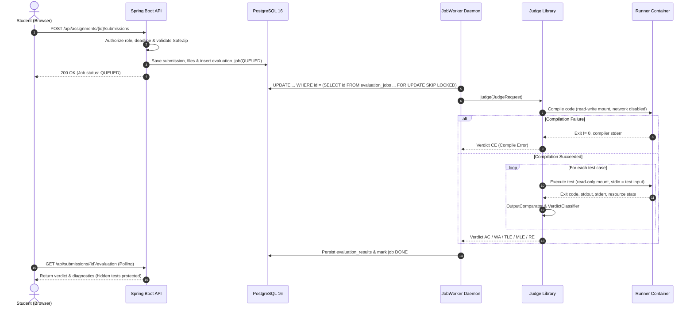

<div align="center">

# CALIPER

### The Precision Instrument for Code Evaluation & Academic Integrity

A unified, self-hosted platform for computer science education: sandboxed multi-language code judging, explainable dual-engine similarity analysis, and native LTI 1.3 LMS integration.

[](https://openjdk.org/projects/jdk/21/)
[](https://spring.io/projects/spring-boot)
[](https://react.dev/)
[](https://www.typescriptlang.org/)
[](https://www.postgresql.org/)
[](https://gvisor.dev/)
[](https://www.1edtech.org/standards/lti)
[](docs/TEST_PLAN_AND_RESULTS.md)
[](LICENSE)

<p align="center">
  <a href="#-overview--motivation">Overview</a> •
  <a href="#-core-capabilities">Capabilities</a> •
  <a href="#-application-showcase">Showcase</a> •
  <a href="#-architecture--system-topology">Architecture</a> •
  <a href="#-tech-stack">Tech Stack</a> •
  <a href="#-getting-started">Quick Start</a> •
  <a href="#-testing--verification">Testing</a> •
  <a href="#-technical-documentation-suite">Documentation</a>
</p>

</div>

---

## 📌 Overview & Motivation

**Caliper** is an open, self-hosted academic platform engineered specifically for university computer science departments. It consolidates in-browser coding workspaces, isolated containerized test execution, strategy-based assessment grading, and explainable code similarity investigations into a single, cohesive system.

Built entirely with modern open technologies, Caliper eliminates expensive per-submission cloud autograder subscriptions, opaque commercial plagiarism algorithms, and invasive student surveillance tools. All source code, student data, and test executions remain strictly within the institution's control.

### The Problem Caliper Solves

Higher education programming courses typically face two compounding points of friction:

1. **Toolchain Fragmentation**: Instructors are forced to juggle disconnected systems—generic learning management systems (e.g., Canvas, Moodle) that lack native compilation environments, third-party autograders with per-submission metering, and standalone web IDEs where student progress is frequently lost.
2. **The "Black Box" Plagiarism Trap**: Commercial similarity checkers return arbitrary percentage scores without verifiable technical justification. Standard starter code, common textbook algorithms, and cosmetic variable renamings routinely produce false accusations or evade detection altogether.

### The Caliper Solution

- **Deterministic & Explainable**: Similarity analysis pairs lexical tokenization (Winnowing + Running Karp-Rabin Greedy String Tiling) with structural Abstract Syntax Tree (AST) parsing via Tree-sitter. Matched fragments are displayed side-by-side with exact file, line, and token coordinates.
- **An Investigation Signal, Not an Accusation**: Statistical similarity never triggers automatic penalties or disciplinary flags. The system prioritizes candidate pairs for qualified instructor review and provides formal audit dispositions (`CONFIRMED_CONCERN`, `DISMISSED`, `INCONCLUSIVE`).
- **Standardized Multi-Language Sandboxing**: Student programs execute in rootless, isolated containers with network access disabled, capabilities dropped, strict resource quotas, and dual watchdog timers.
- **LTI 1.3 Advantage Ready**: Caliper integrates natively into university LMS platforms (such as Canvas) via 1EdTech LTI 1.3 Core, supporting single sign-on (OIDC) and Assignment and Grade Services (AGS) automated grade passback.

---

## 👥 Target Users & Core Experiences

```
                                  CALIPER PLATFORM
                ┌───────────────────────┴───────────────────────┐
                ▼                                               ▼
       INSTRUCTOR WORKFLOW                              STUDENT WORKFLOW
┌───────────────────────────────┐               ┌───────────────────────────────┐
│     Similarity Review Desk    │               │        Coding Workspace       │
│  • Course & assignment setup  │               │  • In-browser CodeMirror IDE  │
│  • Sample & hidden test cases │               │  • Interactive scratchpad     │
│  • Starter code subtraction   │               │  • Public test execution      │
│  • Winnowing & RKR-GST tiling │               │  • Real-time compiler diffs   │
│  • Tree-sitter AST structural │               │  • Local draft persistence    │
│  • Side-by-side syntax viewer │               │  • Multi-attempt tracking     │
│  • Formal PDF dossier export  │               │  • Immediate feedback loops   │
│  • Formal triage dispositions │               │  • Protected hidden tests     │
└───────────────────────────────┘               └───────────────────────────────┘
```

### The Student Experience
- **In-Browser Coding Workspace**: A low-latency web IDE powered by CodeMirror 6 with syntax highlighting, auto-indentation, and line-level error annotations for **C, C++, Java, Python, and JavaScript/Node.js**.
- **Interactive Scratchpad**: Students test public sample inputs, write custom test cases, and inspect raw compiler diagnostics (`stdout`/`stderr`) in real time before formal submission.
- **Protected Verification**: Hidden grading test cases remain confidential on the server; students receive execution status, execution time, and pass/fail counts without exposing private assessment suites.
- **Draft Auto-Save & History**: Automatic browser-session persistence preserves in-progress work, and multi-attempt tracking records incremental progress toward assignment goals.

### The Instructor Experience
- **Course & Roster Management**: Create course sections, manage enrollment access codes, upload starter templates, specify private reference solutions, and configure strict per-assignment CPU/memory quotas.
- **Polymorphic Assessment Authoring**: Build hybrid assessments combining automated programming problems with structured quizzes (Multiple Choice, Multi-Select, True/False, Short Answer, Fill-in-the-Blank, Code Output, and Manual Review).
- **Similarity Review Desk**: Explore candidate plagiarized pairs prioritized by evidence score, view syntax-aligned diffs with starter code subtracted, and record official faculty dispositions.
- **Hearing-Ready Dossier Generation**: Export publication-grade Academic Integrity Hearing Dossiers in printable PDF format (via OpenPDF), self-contained semantic HTML, or structured JSON for departmental committees.

---

## ⚡ Core Capabilities

### 1. Automated Code Evaluation
Submissions are evaluated asynchronously through a database-backed producer-consumer queue (`evaluation_jobs`) using PostgreSQL row-level locks (`FOR UPDATE SKIP LOCKED`).
- **Comprehensive Verdict Taxonomy**:
  - `AC` (Accepted): Output matches expected test data under the comparison policy.
  - `WA` (Wrong Answer): Program ran cleanly but output deviated from expected results.
  - `CE` (Compile Error): Compilation failed; full compiler error logs captured.
  - `TLE` (Time Limit Exceeded): Execution exceeded configured CPU or wall-clock timeout.
  - `MLE` (Memory Limit Exceeded): Program exceeded memory allocation limits (OOM terminated).
  - `RE` (Runtime Error): Nonzero exit status, segmentation fault, or fatal uncaught exception.
  - `IE` (Internal Execution Error): Sandbox runner unavailable; explicitly categorized to avoid penalizing students.
- **Strict Output Comparison Policy**: Line endings are normalized (`\r\n` $\equiv$ `\n`), trailing line whitespace is stripped, and trailing blank lines at the end of output are ignored. Token order, case sensitivity, interior spacing, and numeric representation (`1` vs `1.0`) are strictly enforced.

### 2. Multi-Runtime Sandbox Isolation
Untrusted user submissions execute inside ephemeral container environments configured with defensive host protections:
- **Network Isolation**: `--network none` disconnects the container from all virtual and physical networks, eliminating reverse shells, port scanning, and cloud metadata harvesting (`169.254.169.254`).
- **Read-Only Root Filesystem**: Mounted with `--read-only`; the container cannot modify system binaries or libraries.
- **Ephemeral Scratch Storage**: Temporary file generation is constrained to an isolated `tmpfs` mounted with `noexec,nosuid,size=64m`.
- **Least Privilege Execution**: Containers execute strictly under unprivileged user `nobody:65534` (`--user 65534:65534`) with all Linux kernel capabilities dropped (`--cap-drop ALL`) and `--security-opt no-new-privileges:true`.
- **Resource Limits**: Strict cgroups quotas enforce caps per execution (`--cpus=1.0`, `--memory=256m`, `--memory-swap=256m`, `--pids-limit=64`).
- **Pluggable gVisor Virtualization**: In addition to standard Docker `runc`, Caliper features built-in support for Google's `runsc` user-space kernel runtime (`CALIPER_SANDBOX_RUNTIME=gvisor`), neutralizing host kernel exploit vectors.
- **SafeZip Archive Ingestion Guard**: `SafeZipExtractor` prevents Zip Slip directory traversal attacks (`../`), nested decompression bombs, symlink escapes, and uncompressed storage quotas.

### 3. Explainable Dual-Engine Similarity Analysis
Caliper analyzes code similarity strictly within the scope of a single assignment to protect student privacy and avoid cross-assignment false positives:
- **Lexical Tokenization & Normalization**: Hand-crafted scanners for C, C++, Java, Python, and JavaScript tokenize code, strip comments/whitespace, and normalize variable identifiers by unit-scoped first occurrence (`FIRST_OCCURRENCE_UNIT`).
- **Starter Code Subtraction**: Common instructor-supplied starter templates and boilerplate headers are subtracted from token streams before fingerprinting.
- **Winnowing & Inverted Index**: Computes rolling Rabin-Karp hashes ($k=10$, $w=5$) and selects guaranteed-dense fingerprint subsets, querying an inverted index to avoid $O(N^2)$ pairwise comparisons.
- **Greedy String Tiling (RKR-GST)**: Running Karp-Rabin Greedy String Tiling identifies exact maximal common token tiles on candidate pairs.
- **Tree-sitter AST Structural Parsing**: Generates syntax subtree hash vectors and statement ordering profiles to identify structural clones that survive lexical renaming.
- **Rarity Weighting**: Common idioms and widespread syntactic structures shared across many students are automatically down-weighted.

### 4. Enterprise LMS Interoperability & Dossiers
- **1EdTech LTI 1.3 Advantage Core**: Complete Canvas LMS integration with OIDC third-party login initiation, public JWKS key rotation (`/api/lti/jwks`), state/nonce replay validation, and Assignment and Grade Services (AGS) automated grade synchronization.
- **Polymorphic Dossier Export**: One-click generation of formal disciplinary dossiers via `DossierExportRegistry` in **PDF (OpenPDF)**, **HTML**, and **JSON** formats, complete with timestamps, dual forensic scores, and matched code excerpts.

---

## 🖼️ Application Showcase

<table align="center" width="100%">
  <tr>
    <td width="50%" align="center">
      <strong>Student Coding Workspace Hub</strong><br>
      <sub>Multi-language in-browser IDE with instant test runner and compiler feedback.</sub><br><br>
      
    </td>
    <td width="50%" align="center">
      <strong>Instructor Similarity Review Desk</strong><br>
      <sub>Side-by-side evidence inspection with token coordinates and syntax highlighting.</sub><br><br>
      
    </td>
  </tr>
  <tr>
    <td width="50%" align="center">
      <strong>Instructor Analytics Dashboard</strong><br>
      <sub>Submission throughput, pass rates, and active course management.</sub><br><br>
      
    </td>
    <td width="50%" align="center">
      <strong>Course & Assessment Management</strong><br>
      <sub>Modular assignment authoring, hidden test cases, and quiz configurations.</sub><br><br>
      
    </td>
  </tr>
  <tr>
    <td width="50%" align="center">
      <strong>Secure Login & Onboarding</strong><br>
      <sub>Split sign-in with access code registration and role authentication.</sub><br><br>
      
    </td>
    <td width="50%" align="center">
      <strong>Accessible Dark Mode Review Desk</strong><br>
      <sub>High-contrast dark mode for extended faculty review sessions.</sub><br><br>
      
    </td>
  </tr>
</table>

---

## 🏗️ Architecture & System Topology

Caliper is architected as a **modular monolith** with decoupled Java libraries and an independent Single Page Application (SPA). The similarity engine and execution judge operate as pure, framework-independent libraries:

```
┌─────────────────────────────────────────────────────────────────────────────┐
│                           CALIPER SYSTEM TOPOLOGY                           │
├─────────────────┬───────────────────────────────────────────────────────────┤
│ engine/         │ Pure Java 21 Library (Zero Spring, Zero DB dependencies)  │
│                 │ • Lexical Tokenizers (C, C++, Java, Python, JS)           │
│                 │ • Unit-Scoped Identifier Normalization                    │
│                 │ • Tree-sitter AST Native Structural Parsing               │
│                 │ • Winnowing Fingerprinting & Inverted Index               │
│                 │ • RKR-GST Substring Alignment & Triage Analysis           │
├─────────────────┼───────────────────────────────────────────────────────────┤
│ judge/          │ Pure Java 21 Library (Zero Spring, Zero DB dependencies)  │
│                 │ • ContainerRunner & Execution Provider Port               │
│                 │ • Docker (runc) & Google gVisor (runsc) Providers         │
│                 │ • Language Build Adapters (C, C++, Java, Python, Node)    │
│                 │ • Output Capture, Watchdogs & Verdict Classification      │
├─────────────────┼───────────────────────────────────────────────────────────┤
│ backend/        │ Spring Boot 3.3.5 Application                             │
│                 │ • REST API Endpoints & Role-Based Security (JWT + BCrypt) │
│                 │ • Layered Domain Services (Course, Assignment, Quiz)      │
│                 │ • Polymorphic Question Grading Strategy Engine            │
│                 │ • Background Database Job Worker (SKIP LOCKED)            │
│                 │ • LTI 1.3 Advantage Core (OIDC, JWKS, AGS Grade Passback) │
│                 │ • Polymorphic Dossier Exporters (OpenPDF, HTML, JSON)     │
├─────────────────┼───────────────────────────────────────────────────────────┤
│ frontend/       │ React 18 + TypeScript + Vite Single Page Application      │
│                 │ • Role-Based Views (Student Hub & Instructor Desk)        │
│                 │ • CodeMirror 6 In-Browser Coding Workspace                │
│                 │ • Side-by-Side Visual Similarity Diff Viewer              │
│                 │ • Accessible Light & Dark Themes                          │
└─────────────────┴───────────────────────────────────────────────────────────┘
```

### Asynchronous Submission & Judging Pipeline



<details>
<summary><strong>📁 Click to expand repository directory structure</strong></summary>

```
CALIPER/
├── backend/                       # Spring Boot 3.3.5 web application
│   ├── src/main/java/             # Controllers, domain services, security, workers
│   ├── src/main/resources/        # application.yml, Flyway DB migrations (V1-V8)
│   └── pom.xml
├── engine/                        # Pure Java 21 plagiarism detection library
│   ├── src/main/java/             # Tokenizers, winnowing, inverted index, Tree-sitter AST
│   ├── src/test/resources/        # Synthetic ground-truth quality benchmark fixtures
│   └── pom.xml
├── judge/                         # Pure Java 21 container sandbox & grading library
│   ├── src/main/java/             # Language adapters, DockerRunner, gVisor provider, classifier
│   └── pom.xml
├── frontend/                      # React 18 + TypeScript + Vite Single Page Application
│   ├── src/components/            # CodeMirror editor, assessment settings, diff viewer
│   ├── src/pages/                 # Workspace, Similarity Hub, Dashboard, Courses, Quizzes
│   ├── package.json
│   └── vite.config.ts
├── sandbox/                       # Standardized container runner definitions
│   └── Dockerfiles/               # native.Dockerfile, java.Dockerfile, python.Dockerfile, node.Dockerfile
├── scripts/                       # Local build, environment check & verification scripts
│   ├── windows/                   # Native PowerShell build and runner scripts
│   ├── build-sandbox-images.sh    # Runner image build script for Linux/macOS
│   └── make-quality-fixtures.py   # Benchmark fixture generator
├── deploy/                        # Production deployment configurations
│   ├── Caddyfile                  # Caddy reverse proxy with automatic HTTPS
│   ├── codesentinel.service       # Systemd production service unit
│   ├── install-ubuntu.sh          # Ubuntu LTS automated installer
│   └── backup.sh                  # Database and storage backup automation
├── docs/                          # Comprehensive technical documentation suite
│   ├── screenshots/               # Application interface screenshots
│   ├── results/                   # Raw benchmark logs & quality measurement reports
│   ├── ARCHITECTURE.md            # Topology, sequence diagrams, and ADRs
│   ├── SECURITY.md                # Threat model and sandbox isolation flags
│   ├── OOPS_DESIGN.md             # Object-oriented architecture and SOLID specifications
│   ├── PLAGIARISM_BENCHMARK.md    # Empirical accuracy benchmarks & mathematical formulation
│   ├── TEST_PLAN_AND_RESULTS.md   # Test strategy and measured execution results
│   ├── WORKERS_AND_JOBS.md        # PostgreSQL concurrency and worker fault recovery
│   ├── DEVELOPMENT.md             # Local setup and contributor guide
│   ├── DEPLOYMENT.md              # Production Ubuntu server deployment guide
│   └── API.md                     # REST API endpoint reference
├── compose.yaml                   # PostgreSQL 16 container definition
├── .env.example                   # Environment configuration template
└── pom.xml                        # Maven multi-module root build configuration
```
</details>

---

## 💻 Tech Stack

| Domain | Technologies & Libraries | Purpose |
| :--- | :--- | :--- |
| **Backend Core** | `Java 21 LTS`, `Spring Boot 3.3.5`, `Spring Security`, `Flyway` | High-throughput REST API, transactional services, and database migrations. |
| **Database** | `PostgreSQL 16`, `HikariCP`, `Spring JdbcClient` | Relational storage, concurrency-safe worker queue (`FOR UPDATE SKIP LOCKED`). |
| **Plagiarism Engine** | `Pure Java 21`, `Tree-sitter 0.24`, `SplitMix64`, `Rabin-Karp` | Lexical tokenization, rolling hashes, inverted index, AST structural comparison. |
| **Sandbox Runtime** | `Docker (runc)`, `Google gVisor (runsc)`, `Alpine Linux` | Rootless, capability-dropped, network-isolated container execution environments. |
| **Frontend UI** | `React 18.3`, `TypeScript 5.6`, `Vite 5.4`, `CodeMirror 6` | Low-latency coding workspace, side-by-side diff viewers, and role-based desks. |
| **Document Export** | `OpenPDF 2.0` | Server-side programmatic rendering of Academic Integrity Hearing Dossiers. |
| **Interoperability** | `1EdTech LTI 1.3 Advantage Core`, `RSA-2048`, `JWKS` | Single sign-on and Assignment and Grade Services (AGS) score synchronization. |
| **Testing** | `JUnit 5`, `MockMvc`, `Vitest 2.1`, `React Testing Library` | Multi-tier unit, container integration, and end-to-end API verification. |

---

## 🚀 Getting Started

### Prerequisites

Ensure the following tools are installed on your host system:

| Tool | Minimum Version | Verified Version | Purpose |
| :--- | :---: | :---: | :--- |
| **Java JDK** | `21+` | OpenJDK 25 / 21 LTS | Backend application, judge, and similarity engine. |
| **Apache Maven** | `3.9+` | Maven 3.9.9 | Multi-module build tool. |
| **Node.js & npm** | `20+ LTS` | Node v22.23 / npm 10.9 | React frontend toolchain. |
| **Docker Engine** | `24+` | Docker 29.7 / Desktop | Sandboxed container execution. |
| **PostgreSQL** | `16+` | PostgreSQL 16.15 | Primary relational datastore (or use Compose). |

---

### Step-by-Step Installation

#### 1. Clone the Repository
```bash
git clone https://github.com/HARSH4885-svg/Caliper-College-Team.git
cd Caliper-College-Team
```

#### 2. Configure Environment
Copy the environment template:
```bash
cp .env.example .env
```
*(The default `.env.example` contains sensible defaults for local evaluation).*

#### 3. Start Database Service
Start the PostgreSQL container:
```bash
docker compose up -d
```
Verify the container is healthy:
```bash
docker ps --filter "name=codesentinel-postgres"
```

#### 4. Build Sandbox Runner Images
Build the standardized, isolated container runner images:

```bash
# On Linux / macOS (Bash):
./scripts/build-sandbox-images.sh

# On Windows (PowerShell):
.\scripts\windows\build-sandbox-images.ps1
```
*This compiles `codesentinel/runner-native:1`, `runner-java:1`, `runner-python:1`, and `runner-node:1`.*

#### 5. Launch the Application

##### Option A: Quick Demonstration Mode (Automated)
Run the automated launcher script to build the frontend, package the backend, initialize demo data, and start Caliper:
```bash
bash deploy/presentation.sh
```

##### Option B: Standard Local Development
Start the Spring Boot backend in one terminal:
```bash
mvn spring-boot:run -pl backend
```
The backend initializes the database schema with Flyway and starts on `http://127.0.0.1:8080`.

In a second terminal, start the Vite development server:
```bash
cd frontend
npm install
npm run dev
```
The frontend UI will be accessible at `http://127.0.0.1:5173`.

---

### Pre-Seeded Demonstration Accounts

When `SEED_DEMO=true` or `APP_SEED_DEMO=true` is enabled, the platform seeds standard demonstration accounts:

| Role | Email Address | Password | Permissions Scope |
| :--- | :--- | :--- | :--- |
| **Instructor** | `demo-instructor@demo.invalid` | `demo-password-1` | Lead instructor across seeded courses (CS201, CS301). |
| **Student 1** | `student1@demo.invalid` | `demo-password-1` | Enrolled in CS201 & CS301 (has sample submissions). |
| **Student 2** | `student2@demo.invalid` | `demo-password-1` | Enrolled in CS201 & CS301 (has sample submissions). |
| **Student 3** | `student3@demo.invalid` | `demo-password-1` | Enrolled in CS201 & CS301 (has sample submissions). |

> [!WARNING]
> These credentials are for local demonstration and evaluation only. Production deployments must set `SEED_DEMO=false` and configure unique secrets.

---

## 📖 Workflows & Usage

### Instructor Workflow
1. **Course Creation**: Create a course section (e.g. `CS201: Data Structures`) and generate a unique course enrollment code.
2. **Assignment Authoring**: Define deadlines, memory/time limits, upload starter templates, and set sample/hidden test cases.
3. **Plagiarism Investigation**: Navigate to the assignment's **Similarity Review Desk**, click **Run Comparison**, and inspect triaged pairs.
4. **Side-by-Side Review**: Inspect matched token fragments with starter code subtracted, view syntax trees, and assign a formal disposition (`CONFIRMED_CONCERN`, `DISMISSED`, `INCONCLUSIVE`).
5. **Dossier Export**: Download a formal Academic Integrity Hearing Dossier in PDF format for institutional review.

### Student Workflow
1. **Enrollment**: Sign up using the course enrollment code provided by the instructor.
2. **Interactive Coding**: Open the **Coding Workspace**, select the assignment, and write code in the integrated CodeMirror editor.
3. **Pre-Submission Testing**: Run code against visible sample test cases and inspect compiler outputs in the scratchpad.
4. **Submission & Verdict**: Submit code for evaluation; track real-time container grading status (`AC`, `WA`, `TLE`, etc.) without exposing hidden test cases.

---

## 🧪 Testing & Verification

Caliper maintains a multi-tier automated test suite covering algorithms, container sandboxing, REST APIs, and frontend components:

```
Automated Test Verification Matrix
├── Java Backend Reactor (200 tests passed, 0 failures, 0 skipped)
│   ├── engine/   -> 75 tests (Lexers, Winnowing, GST, AST, Benchmarks)
│   ├── judge/    -> 50 tests (Language adapters, Docker sandbox integration)
│   └── backend/  -> 75 tests (AcceptanceTest E2E, Storage, Quiz, LTI 1.3)
└── Frontend Suite     (40 tests passed, 0 failures)
    ├── Unit & Components  -> 29 tests (Editor, Charts, Workspace, Navigation)
    └── Feature Workflows  -> 11 tests (Quiz runner, Account, Line marks)
Total Verified Tests: 240 Passing
```

### 1. Run Complete Backend Test Suite
Ensure the PostgreSQL container is running, then execute:
```bash
export POSTGRES_PASSWORD=change-me-local-only
mvn test
```

### 2. Run Individual Module Tests
```bash
# Plagiarism engine algorithms, AST parsers, and benchmarks
mvn test -pl engine

# Container sandbox isolation & judge language adapters (requires Docker)
mvn test -pl judge

# Backend REST API, RBAC security, and acceptance scenarios
mvn test -pl backend
```

### 3. Run Frontend Test Suite
```bash
cd frontend
npm test
```

### 4. Run Frontend Production Build & Typecheck
```bash
cd frontend
npm run build
```

---

## 🔒 Security & Sandbox Isolation Model

Caliper implements defense-in-depth isolation across all application layers:

| Security Layer | Implemented Mechanisms | Protection Boundary |
| :--- | :--- | :--- |
| **Process Sandbox** | `--network none`, `--read-only`, `--cap-drop ALL`, `no-new-privileges`, `user nobody:65534` | Prevents network egress, file tampering, privilege escalation, and host breakout. |
| **Resource Quotas** | `--cpus=1.0`, `--memory=256m`, `--pids-limit=64`, dual watchdogs | Neutralizes fork bombs, infinite allocation loops, and host resource exhaustion. |
| **Virtualization Runtime** | Docker `runc` or Google gVisor `runsc` | gVisor intercepts syscalls in user space, eliminating shared kernel vulnerabilities. |
| **Archive Ingestion** | `SafeZipExtractor` path canonicalization & size budgets | Blocks Zip Slip traversal attacks (`../`), nested archive bombs, and symlink exploits. |
| **Access Control (RBAC)** | Server-side `Access` service verifying role and enrollment boundaries | Foreign resources return HTTP 404 to avoid disclosing entity existence to unauthorized users. |
| **Secret Hygiene** | Environment variables, `.env` git-ignored, minimum 32-character JWT secrets | Prevents secret leakage; hardens token signing against brute-force attacks. |

---

## ⚠️ Known Limitations & Operational Realities

1. **Benchmark Ground Truth**: Similarity precision (100%) and recall (100%) were measured on a synthetic ground-truth corpus with controlled adversarial transformations. While realistic, evaluation on uncontrolled real-world student datasets was not conducted.
2. **Local-First Architecture**: Caliper is optimized for single-institution or department-level hosting. Clustering across multiple physical server nodes requires a shared network volume for storage or an object-store adapter.
3. **Stateless Token Invalidation**: Authentication tokens are stored client-side in session storage; server-side blocklisting or instant revocation requires configuring short token lifetimes (`JWT_TTL_MINUTES`).

---

## 📚 Technical Documentation Suite

For exhaustive engineering specifications, architectural contracts, and threat models, refer to the documents in [`docs/`](docs/):

- [`docs/ARCHITECTURE.md`](docs/ARCHITECTURE.md) — Modular monolith topology, sequence diagrams, and Architectural Decision Records (ADRs).
- [`docs/SECURITY.md`](docs/SECURITY.md) — 10-point threat model, sandbox security flags, SafeZipExtractor, and RBAC authorization matrix.
- [`docs/OOPS_DESIGN.md`](docs/OOPS_DESIGN.md) — Object-oriented architecture, SOLID principles in practice, and Mermaid UML class diagrams.
- [`docs/PLAGIARISM_BENCHMARK.md`](docs/PLAGIARISM_BENCHMARK.md) — Empirical quality evaluation, synthetic ground-truth corpus, mathematical formulations, and measured benchmarks.
- [`docs/TEST_PLAN_AND_RESULTS.md`](docs/TEST_PLAN_AND_RESULTS.md) — Multi-tier test strategy, measured execution results, and cyclomatic complexity analysis.
- [`docs/WORKERS_AND_JOBS.md`](docs/WORKERS_AND_JOBS.md) — PostgreSQL concurrency semantics (`FOR UPDATE SKIP LOCKED`), state lifecycle, and fault recovery.
- [`docs/DEVELOPMENT.md`](docs/DEVELOPMENT.md) — Local developer environment setup, prerequisite checks, and test runner instructions.
- [`docs/DEPLOYMENT.md`](docs/DEPLOYMENT.md) — Production Ubuntu LTS server installation, Caddy reverse proxy, systemd daemon, and disaster recovery restore drill.
- [`docs/API.md`](docs/API.md) — REST endpoint specifications, payload schemas, and error conventions.

---

## 👥 Team & Contributors

1. **HARSHVARDHAN** — IIT2025177
2. **TUSHAR RANA** — IIT2025165
3. **LAKSHAY ARORA** — IIT2025117

---

## 📄 License & Acknowledgements

- **License**: This project is licensed under the **Academic & Educational Evaluation License**. See [`LICENSE`](LICENSE) for terms.
- **Core Scientific Acknowledgements**:
  - *Winnowing: Local Algorithms for Document Fingerprinting* — Saul Schleimer, Daniel S. Wilkerson, Alex Aiken (ACM SIGMOD, 2003).
  - *String Similarity via Greedy String Tiling and Running Karp-Rabin Matching* — Michael J. Wise (Basser Department of Computer Science, University of Sydney, 1996).
  - *Tree-sitter Parsing Engine* — Max Brunsfeld et al. (GitHub).
- **Typography**: [Geist](https://vercel.com/font) and [Geist Mono](https://vercel.com/font) by Vercel; [Bricolage Grotesque](https://github.com/ateliertriay/bricolage) by Mathieu Triay.
