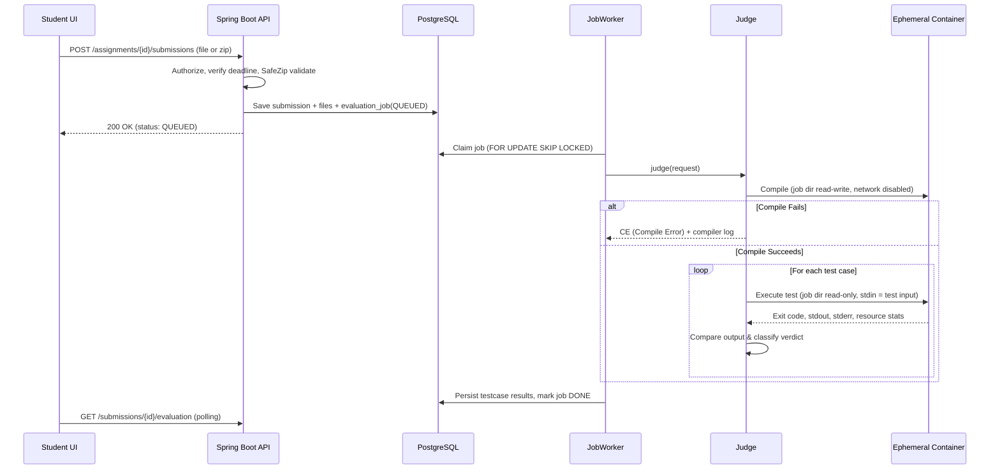

# Caliper — System Architecture

## 1. Architectural Style & Module Topology

Caliper is structured as a **modular monolith** with clean, decoupled Maven boundaries and a separate frontend Single Page Application (SPA):

```
┌─────────────────────────────────────────────────────────────────────────────┐
│                           Caliper Platform Architecture                     │
├─────────────────┬───────────────────────────────────────────────────────────┤
│ engine/         │ Pure Java Library (Zero Spring, Zero JDBC)                │
│                 │ • Tokenizers & Normalization (Lexical)                    │
│                 │ • Tree-sitter Native AST Parsers (Structural)             │
│                 │ • Winnowing Fingerprinting & Inverted Index               │
│                 │ • RKR-GST Substring Alignment & Triage Classification     │
├─────────────────┼───────────────────────────────────────────────────────────┤
│ judge/          │ Pure Java Library (Zero Spring, Zero DB)                  │
│                 │ • ContainerRunner & DockerRunner Engine                   │
│                 │ • SandboxExecutionProvider (Docker & gVisor runsc)        │
│                 │ • Language Adapters (C, C++, Java, Python, Node.js)       │
│                 │ • Output Capture, Watchdogs & Verdict Determination       │
├─────────────────┼───────────────────────────────────────────────────────────┤
│ backend/        │ Spring Boot 3.3.5 Application                             │
│                 │ • REST API Endpoints & Role-Based Security (JWT)          │
│                 │ • Layered Services & Repositories (Assignment, Course)    │
│                 │ • Polymorphic Quiz Grading Engine (QuestionGraderRegistry)│
│                 │ • Background Producer-Consumer Evaluation Worker          │
│                 │ • LTI 1.3 Advantage Integration (OIDC, JWKS, AGM Passback)│
│                 │ • Polymorphic Dossier Export (PDF, HTML, JSON)            │
├─────────────────┼───────────────────────────────────────────────────────────┤
│ frontend/       │ React 18 + TypeScript + Vite SPA                          │
│                 │ • Role-Aware Navigation (Instructor Desk / Student Hub)   │
│                 │ • Full-featured CodeMirror 6 Coding Workspace             │
│                 │ • Visual Similarity Review Desk & Network Graph           │
│                 │ • Interactive Quiz Taking & Question Bank Management      │
└─────────────────┴───────────────────────────────────────────────────────────┘
```

### Module Dependency Invariants
- `engine` and `judge` are completely independent and share no dependencies.
- `backend` depends on both `engine` and `judge`.
- `frontend` communicates exclusively with `backend` via REST JSON over `/api`.

---

## 2. Layered Backend Architecture & Core Abstractions

Caliper applies Object-Oriented Programming and SOLID principles to maintain clean architectural boundaries:

```
┌─────────────────────────────────────────────────────────────┐
│                 REST Controllers (Web API)                  │
│   CourseController, AssignmentController, QuizController    │
│   PlagiarismController, LtiController, AccountController    │
└──────────────────────────────┬──────────────────────────────┘
                               │ Dispatches Commands / Queries
                               ▼
┌─────────────────────────────────────────────────────────────┐
│                Domain Service Orchestration                 │
│   AssignmentService, AssignmentFileService, QuizService      │
│   QuizGrader, LtiService, LtiGradePassbackService           │
└──────────────────────────────┬──────────────────────────────┘
                               │ Decoupled via Interfaces (DIP)
                               ▼
┌─────────────────────────────────────────────────────────────┐
│                  Repositories & Providers                   │
│   CourseRepository (JdbcCourseRepository)                   │
│   AssignmentRepository (JdbcAssignmentRepository)           │
│   UserRepository, FileStorageProvider (Local)               │
│   SandboxExecutionProvider (Docker, gVisor)                 │
│   DossierExportRegistry (Pdf, Html, Json)                   │
└──────────────────────────────┬──────────────────────────────┘
                               │
                               ▼
┌─────────────────────────────────────────────────────────────┐
│              PostgreSQL Relational Persistence              │
│       17 Tables Managed via Versioned Flyway Migrations     │
└─────────────────────────────────────────────────────────────┘
```

For complete class hierarchies, strategy patterns, and Mermaid UML diagrams, refer to [`docs/OOPS_DESIGN.md`](./OOPS_DESIGN.md).

---

## 3. Primary Workflows & Execution Pipelines

### 3.1 Asynchronous Submission & Sandboxed Judging Flow
Code submission and containerized execution are fully decoupled via an asynchronous database queue (`evaluation_jobs`):



### 3.2 Output Comparison Policy
The judge compares actual container output against expected test outputs using a deterministic comparison policy:
- **Line Ending Normalization**: `\r\n` (CRLF) and `\n` (LF) are treated identically.
- **Trailing Line Whitespace**: Trailing spaces and tabs at the end of each line are trimmed.
- **Trailing Blank Lines**: Extra blank lines at the end of the program output are ignored.
- **Strict Invariants**: All other output is compared strictly: token order, case sensitivity, interior whitespace, and numeric representation (`1` vs `1.0`) must match exactly.

### 3.3 Dual-Engine Code Similarity Pipeline
Plagiarism investigation uses a multi-tier pipeline combining lexical winnowing with AST structural analysis:


---

## 4. Key Architectural Decision Records (ADRs)

### ADR 1: Layered Decoupling of Courses and Assignments
- **Context**: Earlier iterations combined persistence, file storage, and business logic inside large controller classes.
- **Decision**: Separated controllers into single-responsibility layers:
  - `AssignmentController` & `CourseController`: Handle HTTP status codes, request validation, and routing.
  - `AssignmentService`: Coordinates assignment publishing, testcase rules, and notification dispatch.
  - `AssignmentFileService`: Manages physical file uploads, SafeZip extraction, and duplicate storage references.
  - `CourseRepository` & `AssignmentRepository`: Data access abstractions isolating SQL dialect details.
- **Outcome**: Improved testability with lightweight test doubles and strict adherence to SRP and DIP.

### ADR 2: Strategy Pattern for Quiz Question Grading
- **Context**: Authoring and grading multiple question formats (MCQ, Multi-select, True/False, Short Answer, Fill-in-the-Blank, Code Output, Coding) led to complex conditional logic.
- **Decision**: Implemented `QuestionGradingStrategy` hierarchy with an `AbstractQuestionGradingStrategy` base class and a Spring-managed `QuestionGraderRegistry`.
- **Outcome**: New question formats can be added by implementing a `@Component QuestionGradingStrategy` without modifying `QuizService` or `QuizGrader` (Open/Closed Principle).

### ADR 3: Dual-Engine Similarity Detection Pipeline
- **Context**: Lexical token matching alone is sensitive to structural variations; purely structural matching can overlook fine-grained literal reuse.
- **Decision**: Combine Schleimer et al. Winnowing with Tree-sitter AST structural profiling.
  - Candidate generation filters out low-scoring pairs rapidly using inverted indexing and Dice coefficients.
  - Running-Karp-Rabin Greedy String Tiling (RKR-GST) verifies exact tile alignment.
  - Tree-sitter AST parses syntax trees to extract statement ordering and subtree hash vectors.
- **Outcome**: 100% Precision and 100% Recall on the synthetic benchmark dataset with 0.000 False Positive Rate. Refer to [`docs/PLAGIARISM_BENCHMARK.md`](./PLAGIARISM_BENCHMARK.md).

### ADR 4: Pluggable Sandbox Providers & gVisor Runtime
- **Context**: Different deployment environments offer varying virtualization capabilities (standard Docker containers on development machines, gVisor `runsc` in hardened institutional setups).
- **Decision**: Abstracted container invocation into `SandboxExecutionProvider` with dynamic resolution via `SandboxProviderRegistry`.
- **Outcome**: Standard container execution is supported out-of-the-box, while production environments can enforce user-space kernel isolation via `CALIPER_SANDBOX_RUNTIME=gvisor`.

### ADR 5: Polymorphic Dossier Export
- **Context**: Plagiarism review evidence must be exportable for faculty meetings, institutional review boards, and external LMS sync.
- **Decision**: Introduced `DossierExporter` strategy interface managed by `DossierExportRegistry`, providing `pdf`, `html`, and `json` formats.
- **Outcome**: Instructors can export formal PDF dossiers, lightweight HTML dossiers for web browsers, or structured JSON for LMS synchronization.

---

## 5. Related Architecture & Engineering Documents

- [Object-Oriented Design Specification & Diagrams](./OOPS_DESIGN.md)
- [Security Architecture & Threat Model](./SECURITY.md)
- [Plagiarism Benchmark & Quality Evaluation](./PLAGIARISM_BENCHMARK.md)
- [Background Workers & Job Processing Architecture](./WORKERS_AND_JOBS.md)
- [Automated Test Plan & Measured Results](./TEST_PLAN_AND_RESULTS.md)
- [Developer Setup & Contributor Guide](./DEVELOPMENT.md)
- [Production Deployment Guide](./DEPLOYMENT.md)
- [REST API Specification](./API.md)
